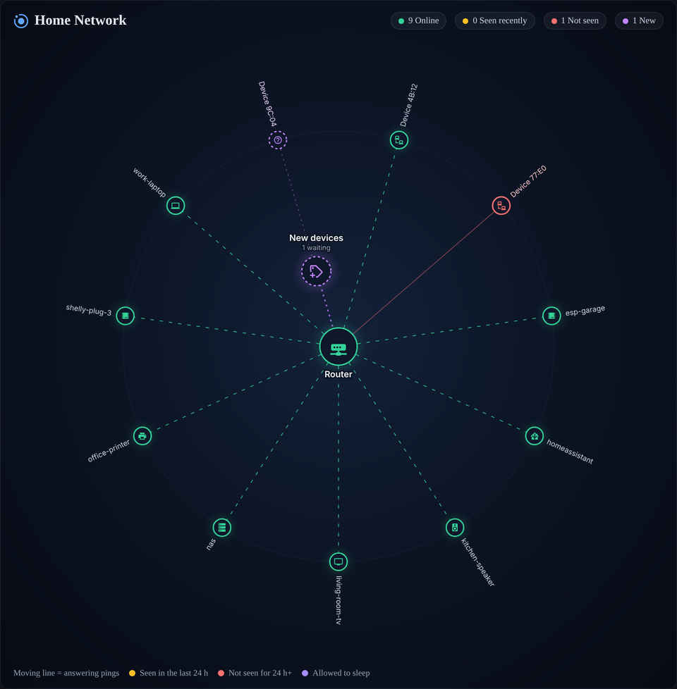

# NetOrbit

A live, radial map of your home network for Home Assistant. Every device orbits the router, switch, access point or mesh node it connects through, colored by whether it's answering right now, was seen recently, or has gone quiet.


- **Finds devices on its own.** Sweeps your subnet, learns MAC addresses from the ARP table and names devices from Home Assistant's device registry or reverse DNS.
- **Automatic or manual.** Track everything it finds, or only the devices you pick while new ones wait in a "New devices" bubble.
- **Remembers when it last saw each device.** Green = answering, yellow = seen within your window (24 h by default), red = gone longer than that. Survives restarts.
- **Events for automations.** `netorbit_new_device`, `netorbit_device_stale` and `netorbit_device_recovered`, plus ready-made notification blueprints.
- **Lightweight.** One ping round per interval (default 60 s) and one subnet sweep every 5 minutes. A few kilobits per second.
- **Card included.** Installing the integration also loads the `custom:netorbit-card`, so there's nothing else to add.

| Wired with access points | Mesh system | Flat network |
| --- | --- | --- |
|  |  |  |

## Install

### HACS

1. In HACS, open the menu, choose **Custom repositories**, add `https://github.com/the-scott-davis/netorbit` with type **Integration**.
2. Install **NetOrbit** and restart Home Assistant.
3. Go to **Settings > Devices & services > Add integration > NetOrbit**.

### Manual

Copy `custom_components/netorbit` into your Home Assistant `config/custom_components` folder and restart.

## Setup

The setup form asks for:

| Field | What it does |
| --- | --- |
| Subnet | The network to map, in CIDR form (for example `192.168.0.0/24`). Prefilled from Home Assistant's network settings. Up to 1024 hosts. |
| Router IP | Becomes the center of the map. |
| Tracking mode | **Automatic** tracks everything it finds. **Manual** only tracks devices you add; everything else appears under "New devices". |
| Ping interval | How often tracked devices are pinged. 60 s is plenty for most homes. |

Then add the card to any dashboard:

```yaml
type: custom:netorbit-card
title: Home Network
```

## Hubs: showing which AP or switch a device uses

Out of the box every device hangs off the router. To group devices by access point, switch or mesh node:

1. Open the integration's **Configure** menu and choose **Add a hub**.
2. Give it a name, an IP if it has one (unmanaged switches don't), a type, and what it connects to. Hubs can nest: router > switch > access point.
3. Use **Edit or stop tracking a device** to set which hub each device connects through.

Automatic hub detection (SNMP switch tables, UniFi and Omada client data) is planned. See the roadmap.

## Options

Everything lives under the integration's **Configure** menu:

- **Settings:** tracking mode, ping interval, discovery interval, how many hours before a device counts as not seen, and whether to ignore randomized MAC addresses.
- **Add a hub / Edit or remove a hub.**
- **Track a device:** pick one NetOrbit has found or enter an IP. Set its name, icon, hub and whether it's allowed to sleep.
- **Edit or stop tracking a device.**
- **Review new devices:** track or ignore several at once.

"Allowed to sleep" is for TVs, consoles and anything else that's off a lot. They still show their status, but never fire `netorbit_device_stale`.

## Card options

| Option | Default | Description |
| --- | --- | --- |
| `title` | `Network` | Card title. |
| `height` | `900` | Maximum height in pixels. |
| `show_ip` | `false` | Show hub IPs under their names instead of the hub type. Off by default so screenshots are safe to share. |
| `show_legend` | `true` | Show the legend at the bottom. |
| `hide_sleepy_offline` | `false` | Hide sleep-allowed devices while they're offline. |
| `device_id` | | Only show one NetOrbit entry when you have several. |

Hover a device for details, tap it for its history. Tap a new device to track or ignore it (admins only).

## Entities, events and services

- One sensor per hub and tracked device. State is `online`, `recent` or `stale`. Attributes include `ip`, `mac`, `link` (the hub), `last_seen`, `first_seen`, `hostname` and `sleepy`.
- `sensor.netorbit_devices_online` counts online devices and lists new devices in its `new_devices` attribute.

| Event | Data |
| --- | --- |
| `netorbit_new_device` | `name`, `ip`, `mac` |
| `netorbit_device_stale` | `name`, `ip`, `mac`, `kind`, `last_seen` |
| `netorbit_device_recovered` | `name`, `ip`, `mac`, `kind`, `last_seen` |

| Service | Fields |
| --- | --- |
| `netorbit.track_device` | `mac` or `ip`, optional `name`, `icon`, `hub`, `sleepy` |
| `netorbit.ignore_device` | `mac` or `ip` |
| `netorbit.scan_now` | none |

### Blueprints

- [Notify when a device goes offline](blueprints/automation/netorbit/device_offline_notify.yaml)
- [Notify when a new device joins](blueprints/automation/netorbit/new_device_notify.yaml)

Import either from **Settings > Automations & scenes > Blueprints > Import blueprint** using the file's GitHub URL.

## Requirements and limits

- Home Assistant needs to be on the same network as your devices, with host networking. Home Assistant OS and supervised installs are. Docker installs need `network_mode: host`.
- Presence is based on ping. Devices that block ping show as not seen even when they're connected. Track those by IP and mark them as allowed to sleep, or ignore them.
- Phones and laptops often use a private MAC address per network. Those are ignored by default since they can change.
- IPv4 only, up to 1024 hosts per entry. Add one entry per subnet if you have several.

## Privacy

NetOrbit runs entirely on your network and never contacts anything outside it. Diagnostics downloads replace every IP, MAC and name with placeholders, so they're safe to attach to an issue.

## Roadmap

- Automatic hub placement from SNMP switch MAC tables, with a port to hub mapping screen.
- Hub placement from UniFi, Omada and other integrations that already know which AP a client is on.
- Optional ARP based presence for devices that block ping.
- A visual card editor.

## Contributing

```bash
python -m venv .venv && . .venv/bin/activate
pip install -r requirements_test.txt
pytest
node --test tests/card.test.js
```

To preview the card with fake data, serve the repo root (`python -m http.server 8766`) and open `http://localhost:8766/scripts/preview/index.html?s=full` (or `mesh`, `flat`).

## License

MIT
